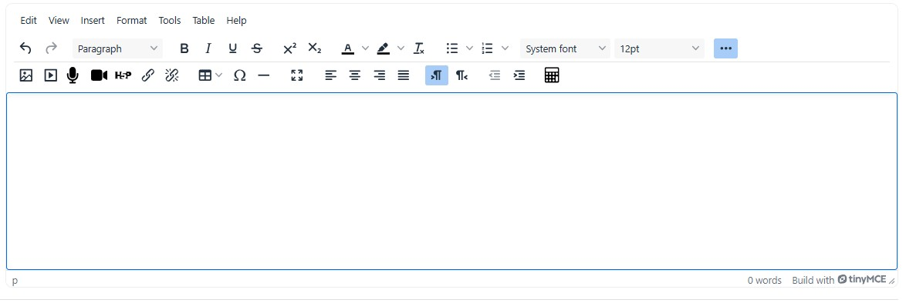
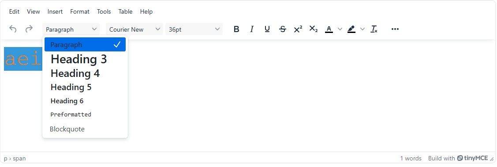
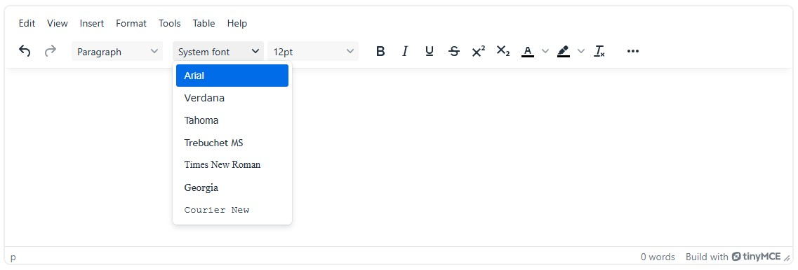
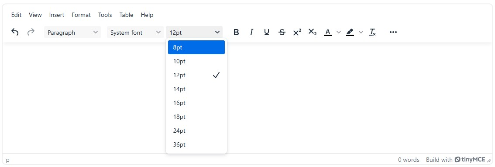
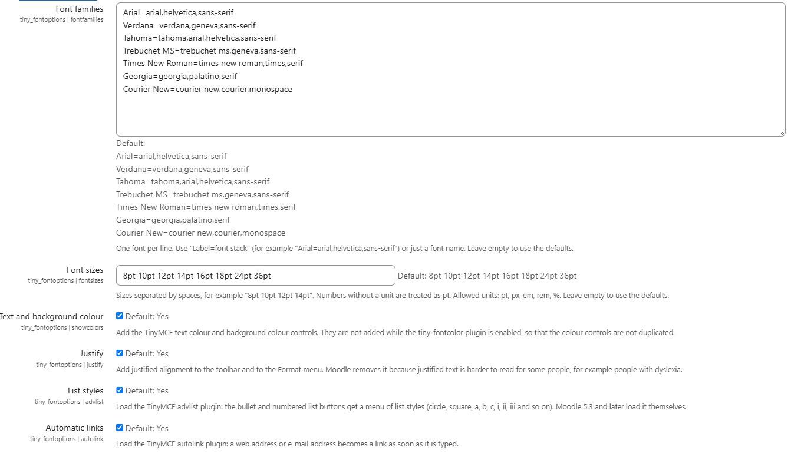
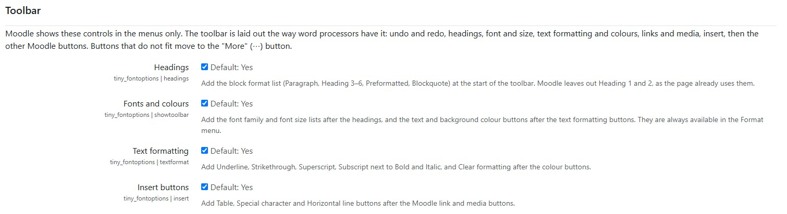

# tiny_fontoptions — Font options for the Moodle TinyMCE editor

Moodle removes several controls that are built into TinyMCE, keeps others in the menus only,
and does not load some of its plugins. This plugin brings them back:

| Feature | Where | Setting |
|---|---|---|
| Font family | Format menu, toolbar | `fontfamilies` — one font per line, `Label=font stack` |
| Font size | Format menu, toolbar | `fontsizes` — e.g. `8pt 10pt 12pt`, a number without a unit is pt |
| Text colour, background colour | Format menu, toolbar | `showcolors` — skipped while `tiny_fontcolor` is enabled |
| Justify | Format menu, alignment buttons | `justify` |
| List styles (TinyMCE advlist) | bullet / numbered list buttons | `advlist` |
| Automatic links (TinyMCE autolink) | typing a URL followed by a space | `autolink` |
| Headings (Paragraph, Heading 3–6, Preformatted, Blockquote) | toolbar | `headings` |
| Underline, Strikethrough, Superscript, Subscript, Clear formatting | toolbar | `textformat` |
| Table, Special character, Horizontal line | toolbar | `insert` |
| Toolbar mode on phones and tablets | toolbar | `mobiletoolbar` |

Access is controlled by the `tiny/fontoptions:use` capability.



## Toolbar layout

The toolbar follows the usual word processor order:

```
computer, tablet: undo redo | headings | B I U S | x² x₂ | colours clear | lists | font size | links media… | table Ω — | …
phone:            undo redo | B I U S | x² x₂ | colours clear | lists | headings | font size | links media… | table Ω — | …
```

On a computer this is the TinyMCE default order (`undo redo | styles | bold italic`). TinyMCE moves whole
sections to the "More" (⋯) drawer, from the end, so the most used ones come first and the wide font lists
after them; the sections are kept short, as the drawer wraps them. Moodle's bullet and numbered lists section
is moved up from the end of the toolbar, where it was always in the drawer. On phones the first row has
room for a few buttons only, so the text formatting comes first.

* `headings` adds the `blocks` section (after undo/redo; on phones after the lists).
* `showtoolbar` adds the `fonts` section (font family, font size) after the lists (on phones after the
  headings), and the colour buttons to the `colors` section.
  The `tiny_fontcolor` buttons are moved to that section too.
* `textformat` adds Underline and Strikethrough after Italic, the `script` section (Superscript, Subscript),
  and Clear formatting at the end of the `colors` section.
* `insert` adds the `insert` section after Moodle's `content` section (link, image, media).
  Table and Special character are only added while Moodle loads those TinyMCE plugins.
* `mobiletoolbar` sets the toolbar mode on phones and tablets: `sliding` (default, as on a computer,
  with the "More" (⋯) button), `scrolling` (the TinyMCE default for these devices: one row that scrolls
  sideways) or `wrap` (all buttons, on as many rows as needed; on a phone they can cover most of the
  editing area).

With the "More" (⋯) button, the editor grows by the height of the opened drawer, so the editing area
keeps its size (Moodle gives the editor a fixed height, and the drawer used to take its space).

A button that is already on the toolbar is not added twice. Moodle configures the Tiny plugins in
alphabetical order, so plugins named after `fontoptions` (h5p, link, media, premium, styles…)
add their buttons after these changes; their positions are left as they are.

Not included on purpose:

* Accordion: Moodle before 5.3 strips `<details>`/`<summary>` when content is displayed.
  Moodle 5.3 enables it itself (MDL-88618).
* Styles, Heading 1 and Heading 2: they would break the page heading structure.
* The `lower-greek` list style is hidden before Moodle 5.3, as HTML cleaning removes it.

If `tiny_fontfamily` or `tiny_fontsize` are enabled, their items appear twice;
the settings page shows a warning. Disable them in
Site administration > Plugins > Text editors > TinyMCE editor > General settings.

## Screenshots

| Headings | Font family | Font size |
|---|---|---|
|  |  |  |

Settings:





## Requirements

Moodle 4.5 – 5.3. Tested on Moodle 5.1.8 and 5.2.4.

## Installation

Site administration > Plugins > Install plugins, upload the ZIP; or extract it to
`lib/editor/tiny/plugins/fontoptions` (`public/lib/editor/tiny/plugins/fontoptions` in Moodle 5.1+)
and visit Site administration > Notifications.

## Building JavaScript

The `amd/build` files are produced from `amd/src` with Moodle's standard `grunt amd`.

## Translations

The plugin ships with English strings only. Translations are managed in AMOS
(https://lang.moodle.org) once the plugin is in the Moodle plugins directory.

## Copyright and license

2026 Donetsk Regional Institute of Postgraduate Pedagogical Education
(https://ippo.dn.ua, donoippo@gmail.com).

This program is free software: you can redistribute it and/or modify it under the terms of the
GNU General Public License as published by the Free Software Foundation, either version 3 of the
License, or (at your option) any later version. See LICENSE.
