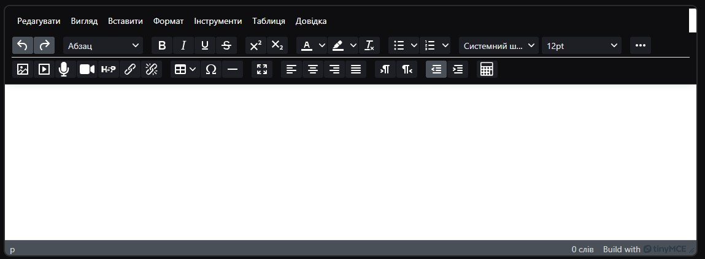
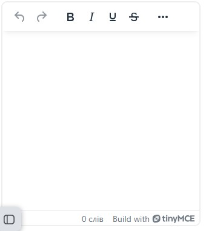
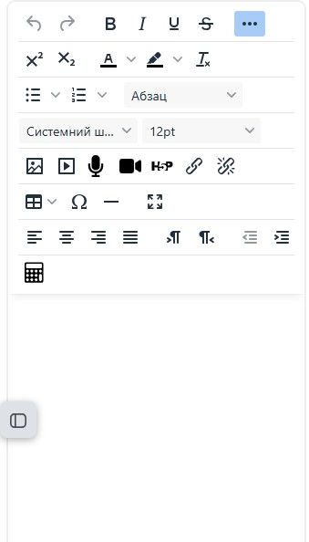

# tiny_fontoptions — Font options for the Moodle TinyMCE editor

Moodle removes several controls that are built into TinyMCE, keeps others in the menus only,
and does not load some of its plugins. This plugin brings them back:

| Feature | Where | Setting |
|---|---|---|
| Font family | Format menu, toolbar | `fontfamilies` — one font per line, `Label=font stack` |
| Font size | Format menu, toolbar | `fontsizes` — e.g. `8pt 10pt 12pt`, a number without a unit is pt |
| Text colour, background colour | Format menu, toolbar | `showcolors` — skipped while `tiny_fontcolor` is enabled |
| Justify | Format menu, alignment buttons | `justify` |
| List styles (TinyMCE advlist) | bullet / numbered list buttons | `advlist` |
| Automatic links (TinyMCE autolink) | typing a URL followed by a space | `autolink` |
| Headings (Paragraph, Heading 3–6, Preformatted, Blockquote) | toolbar | `headings` |
| Underline, Strikethrough, Superscript, Subscript, Clear formatting | toolbar | `textformat` |
| Table, Special character, Horizontal line | toolbar | `insert` |
| All buttons visible when the editor is loaded | toolbar | `expandtoolbar` |
| Toolbar mode on phones and tablets | toolbar | `mobiletoolbar` |

Access is controlled by the `tiny/fontoptions:use` capability.


## Toolbar layout

The toolbar follows the usual word processor order:

```
computer, tablet: undo redo | B I U S | colours clear | x² x₂ Ω | font family, size | headings, indent, lists
                  | align | links | media | table — | full screen | the other buttons
phone:            undo redo | B I U S | colours clear | x² x₂ Ω | font family, size | headings | align | lists
                  | links | media | table — | full screen | the other buttons
```

TinyMCE moves whole sections to the "More" (⋯) drawer, from the end, so the most used ones come first and the
wide lists (fonts, headings) after them; the sections are kept short, as the drawer wraps them. A section wider than
the row is split, so on phones the headings list is a section of its own. The buttons of some other plugins get
their places too, when the site has them: Styles (tiny_styles) after the colours on a computer, MathType and
ChemType (tiny_wiris) and the Moodle equation editor after the special characters (on phones before full screen),
Cancel automatic link (tiny_noautolink) after the links, H5P after the media. All other buttons, such as those of
plugins installed later, follow in their usual sections. The order can be changed in the settings, see below.

* `headings` adds the headings list.
* `showtoolbar` adds the font family and font size lists, and the colour buttons.
  The `tiny_fontcolor` buttons are put in their place too.
* `textformat` adds Underline, Strikethrough, Superscript, Subscript and Clear formatting.
* `insert` adds Special character, Table and Horizontal line.
  Table and Special character are only added while Moodle loads those TinyMCE plugins.
* `mobiletoolbar` sets the toolbar mode on phones and tablets: `sliding` (default, as on a computer,
  with the "More" (⋯) button), `scrolling` (the TinyMCE default for these devices: one row that scrolls
  sideways) or `wrap` (all buttons, on as many rows as needed; on a phone they can cover most of the
  editing area).

A button which a setting leaves out is not shown, even though the default order has a place for it.

With the "More" (⋯) button, the editor grows by the height of the opened drawer, so the editing area
keeps its size (Moodle gives the editor a fixed height, and the drawer used to take its space).

`expandtoolbar` (enabled by default) opens the drawer when the editor is loaded, so all buttons are visible
on a computer or tablet; the "More" button still collapses it. It is not opened on phones, where the extra
rows would take half of the screen.

### Your own toolbar order

`toolbarorder` (computer and tablet) and `toolbarorderphone` (phone) put the toolbar into any order,
with the buttons of other Tiny plugins too. Empty (the default) keeps the default order above. Otherwise one section
per line, button names separated by spaces:

```
undo redo
bold italic underline strikethrough
alignleft aligncenter alignright alignjustify
forecolor backcolor removeformat
bullist numlist
*
```

A button which is not listed is left out of the toolbar (it stays in the menus); the line `*` puts all such
buttons there instead, in their usual sections, so the buttons of plugins installed later show up too.
Buttons which an editor does not have (a disabled plugin, a capability the user lacks) are skipped.
The order is applied when the editor is set up, after every plugin has added its buttons.

Below each setting are the default order on the site, with a button to copy it into the field, and the list
of the buttons for the toolbar and the menu commands (not the context toolbar ones, such as table rows or Heading 1–6). Button names are only known in the browser, so the settings page loads a hidden
editor with the site configuration to read them.
On the page with all TinyMCE settings (`admin/category.php?category=editortiny`) Moodle prints a script
before the page doctype, and TinyMCE does not start in that quirks mode, so the settings link to the plugin
settings page there.

A button that is already on the toolbar is not added twice. Moodle configures the Tiny plugins in
alphabetical order, so plugins named after `fontoptions` (h5p, link, media, premium, styles…)
add their buttons after this plugin; the order is applied when the editor is set up, after all of them.

Not included on purpose:

* Accordion: Moodle before 5.3 strips `<details>`/`<summary>` when content is displayed.
  Moodle 5.3 enables it itself (MDL-88618).
* Styles, Heading 1 and Heading 2: they would break the page heading structure.
* The `lower-greek` list style is hidden before Moodle 5.3, as HTML cleaning removes it.

If `tiny_fontfamily` or `tiny_fontsize` are enabled, their items appear twice;
the settings page shows a warning. Disable them in
Site administration > Plugins > Text editors > TinyMCE editor > General settings.

## Accessibility

Moodle leaves these controls out of the toolbar on purpose, so think about who reads the content:

* Font family, font size and colours are written into the text as inline styles. They override the theme,
  so the text can look different from the rest of the site, and in a dark theme or the Moodle app.
  Keep enough contrast between the text and background colours (WCAG 2.1 asks for 4.5:1 for normal text),
  and do not use colour alone to carry meaning.
* Justified text is harder to read for some people, for example people with dyslexia.
* Headings start at Heading 3, as in Moodle core, so the page heading structure stays correct
  for screen readers. Use headings for structure rather than a bigger font size.

Dark mode: Moodle 5.3 and later use the dark TinyMCE skin in dark mode. Before 5.3, dark mode plugins (such as
local_boost_dark) make the toolbar buttons dark but keep the light skin; when the buttons are dark, the text of the
headings and font lists is made light so that it stays readable.

Every feature can be switched off in the settings, and the `tiny/fontoptions:use` capability can limit the plugin
to some roles, for example teachers only. Moodle's own Accessibility checker (tiny_accessibilitychecker) still
reports low contrast and other issues in the edited text.

## Screenshots

Dark mode (Moodle 5.2 with local_boost_dark):



| Phone | Phone, "More" opened |
|---|---|
|  |  |

| Headings | Font family | Font size |
|---|---|---|
|  |  |  |

Settings:


## Requirements

Moodle 4.5 – 5.3. Tested on Moodle 5.1.8 and 5.2.4.

## Installation

Site administration > Plugins > Install plugins, upload the ZIP; or extract it to
`lib/editor/tiny/plugins/fontoptions` (`public/lib/editor/tiny/plugins/fontoptions` in Moodle 5.1+)
and visit Site administration > Notifications.

## Building JavaScript

The `amd/build` files are produced from `amd/src` with Moodle's standard `grunt amd`.

## Translations

The plugin ships with English strings only. Translations are managed in AMOS
(https://lang.moodle.org) once the plugin is in the Moodle plugins directory.

## Copyright and license

2026 Donetsk Regional Institute of Postgraduate Pedagogical Education
(https://ippo.dn.ua, donoippo@gmail.com).

This program is free software: you can redistribute it and/or modify it under the terms of the
GNU General Public License as published by the Free Software Foundation, either version 3 of the
License, or (at your option) any later version. See LICENSE.
